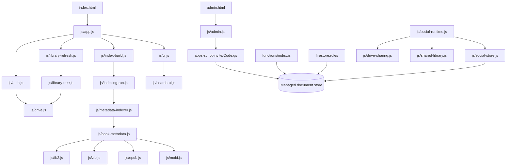

> Частичное обновление 2026-11-09T09:09:25.560Z для коммита 5bb8b837a522566b64fefd36395587dd3431b4a3. В граф добавлен js/google-picker.js, его функции и связи импорта. Полный генератор Understand Anything в доступной среде не найден, поэтому это не полноценный повторный анализ: старые диапазоны строк и эвристические связи остальных модулей могут требовать регенерации.

## Актуальные изменения OAuth и Google Picker

- Полный scope https://www.googleapis.com/auth/drive удалён; широкое чтение сохранено через drive.readonly.
- drive.file даёт изменяемый доступ к конкретным объектам, используемым/выбранным через приложение, а не ко всем файлам корневой папки автоматически.
- js/google-picker.js запрашивает авторизацию точного Drive ID и проверяет ID в callback. После HTTP 403 маркер авторизации сбрасывается.
- Выбор корневой папки не означает автоматическую авторизацию всех вложенных папок.
- drive.file допускает удаление объектов, на которые приложение получило доступ. Полный запрет удаления требует отдельно ограничить DELETE-операции в коде, различая служебные индексы, книжные файлы и отзыв прав.

---

# Тайная Библиотека — архитектура и аудит рисков

> **Статус:** детерминированный анализ Understand Anything 2.9.8. AI-обогащение не запускалось: лимит Codex исчерпан. Исходники, тесты, правила доступа и конфигурация развёртывания не изменялись. Граф вызовов частично эвристический; неоднозначные связи помечены ниже.

## 1. Результат

- Просканировано **125 файлов в графе**: 98 исходников/скриптов, 10 документов, 7 файлов разметки, 10 конфигураций/данных.
- Структурный парсер обработал 114 файлов (с учётом добавленного модуля Google Picker). Для неподдерживаемых им Apps Script и правил доступа добавлены функции через лексический проход.
- Граф: **730 узлов и 2053 ребра** — 587 функций/помощников, 9 классов, 8 callable API, 125 файловых узлов и обобщённый узел хранилища данных.
- Связи: 604 `contains`, 242 `imports`, 1075 `calls`, 124 `tested_by`, 7 связей чтения данных и 1 связь проверки правил.
- **Циклов импортов не найдено** среди 124 файлов и 236 разрешённых локальных импортов.
- Эвристический граф вызовов содержит **123 циклические компоненты-кандидата**. Это не 123 дефекта: в число входят обратные вызовы UI, рекурсия/повторные попытки и лексические совпадения. Проверять нужно конкретные затронутые узлы, а не считать это доказанными ошибками.

Файлы результата: `.ua/knowledge-graph.json`, `.ua/architecture-report.md`, `.ua/intermediate/scan-result.json`, `.ua/intermediate/import-map.json`. Каталог `.ua/` исключён локально через `.git/info/exclude`: карта инфраструктуры не должна случайно попасть в публичный репозиторий.

## 2. Архитектура

Приложение — статический браузерный проект с ES-модулями, отдельной административной страницей, серверным мостом административных операций, серверными callable-обработчиками и правилами доступа к общему документному хранилищу. Индекс книг и обложки хранятся отдельно в пользовательском файловом пространстве.

### Главные подсистемы

1. **Авторизация:** `js/auth.js`, `js/firebase-session.js`, `js/config.js`, `js/firebase-config.js`.
2. **Файловый транспорт:** `js/drive.js` — листинг, пагинация, повторные запросы, Range-чтение, сохранение и удаление файлов данных.
3. **Обход и индекс:** `js/library-tree.js`, `js/library-refresh.js`, `js/library-index.js`, `js/index-build.js`, `js/indexing-run.js`, `js/indexing-checkpoint.js`, `js/metadata-indexer.js`, `js/indexing-state.js`, `js/indexing-errors.js`.
4. **Форматы книг:** `js/book-metadata.js` выбирает обработчик; `js/fb2.js`, `js/zip.js`, `js/epub.js`, `js/mobi.js` извлекают данные; `js/book-content.js` содержит общую обработку текста, превью и обложек.
5. **UI:** `js/ui.js` связывает карточки, поиск, фильтры, пагинацию, друзей, уведомления и настройки.
6. **Социальный доступ:** `js/social-runtime.js`, `js/social-store.js`, `js/social-model.js`, `js/shared-library.js`, `js/drive-sharing.js`, `js/shared-cover-cache.js`.
7. **Админка:** `admin.html` → `js/admin.js` → административный мост в `apps-script-invite/Code.gs`. В репозитории также есть параллельные серверные обработчики в `functions/index.js`.
8. **Безопасность:** `firestore.rules`, `functions/admin-security.js` и серверная проверка прав в административном мосте/обработчиках.
9. **Тесты:** 32 файла в `tests/`, включая сценарии авторизации, доступа, индексирования, парсеров и административной безопасности.

## 3. Критические зависимости

| Узел | Импортная связь | Риск изменения |
|---|---:|---|
| `js/config.js` | 25 входящих | Общие лимиты, версии, ID и типы файлов влияют на множество модулей. |
| `js/drive.js` | 19 входящих | Центральный транспорт; сбой затрагивает сканирование, парсеры, обложки и сохранение. |
| `js/index-build.js` | 12 входящих | Определяет черновик, resume и допустимость финальной замены индекса. |
| `js/metadata-indexer.js` | 11 входящих | Обработка книг, retry и прогресс. |
| `js/fb2.js` | 9 входящих | Базовый парсер, также используется при обработке FB2 внутри ZIP. |
| `js/indexing-errors.js` | 8 входящих | Ошибки и eligibility для повторных попыток. |
| `js/auth.js` | 7 входящих | Токены и восстановление сессии для большинства запросов. |
| `js/book-metadata.js` | 7 входящих, 6 исходящих | Общий диспетчер форматов. |
| `js/library-tree.js` | 7 входящих | Построение индекса из рекурсивного обхода папок. |
| `js/app.js`, `js/ui.js` | по 14 исходящих | Высокая координационная нагрузка; изменение может затронуть много сценариев. |

## 4. API, данные и зависимости

- **Файловый API:** `js/drive.js` — листинг, метаданные, частичное скачивание, JSON и обложки.
- **OAuth/сессия:** `js/auth.js`, `js/firebase-session.js`.
- **Административный мост:** `js/admin.js` отправляет действия в `apps-script-invite/Code.gs`; среди них сводка, постраничные коллекции, отношения, карточки и административные действия.
- **Callable API:** 8 экспортируемых обработчиков в `functions/index.js`: проверка доступа, bootstrap администратора, сводка админки, права, блокировка/восстановление, отзыв приглашения и закрытие связи доступа.
- **Правила доступа:** `firestore.rules` независимо ограничивает чтение/запись профилей, связей и опубликованных каталогов. Серверная проверка и правила должны оставаться согласованными.
- **Хранилища:** индекс, черновик индекса, пользовательские настройки и обложки хранятся отдельно от профилей, социальных связей, блокировок, прав администраторов и журнала событий.
- **Зависимости:** корневой `package.json` содержит инструменты тестирования/CLI; `functions/package.json` задаёт Node.js 22 и серверные SDK. На машине установлен Node.js 24, поэтому локальная среда не идентична среде развёртывания.

## 5. Админка и расход чтений

Важно различать активный путь админки и параллельный серверный обработчик.

### Активный путь

- `js/admin.js` вызывает действие `getAdminDashboardSummary` через `gasRequest()`; это не прямой вызов `functions/index.js:getAdminDashboard`.
- `getAdminDashboardSummaryApi` в `apps-script-invite/Code.gs` явно исключает приглашения из сводки. Комментарий в коде объясняет это устранением лишних чтений при каждом refresh.
- Счётчики используют агрегирующие запросы и кеш на 60 секунд; UID главного администратора кешируется на 30 секунд.
- Списковые API используют курсорную пагинацию по 25 записей. `js/admin.js` кеширует страницы в `adminPageState`, а связи — в `relationshipSharesCache`.
- Для дальнейшей диагностики надо измерять отдельно сводку, страницы участников, связи и запросы профилей, а не предполагать, что каждое обновление перечитывает все документы.

### Остаточный риск

- `functions/index.js:getAdminDashboard` всё ещё делает широкие `.get()` по полным коллекциям и запрашивает группу подколлекций приглашений при наличии права `invites`.
- В отслеживаемых клиентских файлах прямого вызова этого обработчика не найдено: текущая админка использует мост в `Code.gs`. Это потенциально устаревший/параллельный путь; удалять его можно только после проверки развёртывания и внешних клиентов.
- `apps-script-invite/Code.gs` — крупный модуль (1800 строк, около 113 объявлений функций). В нём совмещены административная пагинация, права, приглашения и REST-операции. Изменять его следует точечно.

## 6. Зоны риска

### Высокий риск

1. **Атомарность индекса:** `library-refresh.js`, `index-build.js`, `indexing-run.js`, `library-index.js` и `indexing-checkpoint.js` — единый протокол. Активный индекс должен оставаться рабочим, пока черновик не проверен и не сохранён целиком.
2. **Сохранение метаданных:** `library-tree.js` + `library-refresh.js` должны сохранять метаданные неизменившихся книг и удалять только реально отсутствующие записи.
3. **Транспорт и авторизация:** изменения `drive.js`/`auth.js` могут сломать повторы после истечения токена, HTTP Range, отмену запросов и большинство функций чтения.
4. **Парсеры:** `book-metadata.js`, `zip.js`, `fb2.js`, `epub.js`, `mobi.js`, `book-content.js` используют общие контракты метаданных, превью и обложек.
5. **Границы доступа:** `drive-sharing.js`, `social-store.js`, `shared-library.js`, серверные обработчики и правила доступа должны изменяться согласованно. Отзыв доступа к вложенной папке должен закрывать её и на стороне файлового хранилища: друг может видеть папку в интерфейсе, но не должен иметь возможности войти в неё.
6. **Административные чтения:** не возвращать активную админку к полной загрузке коллекций, не добавлять запросы на каждый рендер и не сбрасывать кеш без необходимости.
7. **Тексты приглашений:** шаблон приглашения — защищённая часть поведения; не менять и не дополнять без прямого запроса.

### Средний риск

- `js/app.js` — оркестратор множества сценариев.
- `js/ui.js` связывает контроллеры; бизнес-логику предпочтительнее держать в узких модулях.
- `js/config.js` хранит версии и лимиты; изменения версии метаданных/индекса требуют проверки миграций.
- `functions/index.js` и `apps-script-invite/Code.gs` содержат параллельные административные пути. До удаления надо подтвердить, какие обработчики реально развёрнуты и используются.

### Циклы

- **Импортные циклы:** не обнаружены.
- **Циклы вызовов:** эвристический анализ подсветил взаимные ссылки UI-рендереров, управление токеном, повторный вызов транспортного слоя и рекурсивные помощники сериализации. Это кандидаты, не доказанные дефекты: callback-вызовы и повторные попытки часто намеренны.

## 7. Безопасная разработка и план проверок

1. Перед правкой проверять входящие/исходящие импорты, функции с прямыми связями и тесты, импортирующие затрагиваемый модуль.
2. Менять один слой за раз: UI → контроллер/сервис → хранилище/правила. Не смешивать рефакторинг и изменение поведения.
3. **Индексатор:** проверить успешный refresh, сохранение старой записи при ошибке, resume, retry выбранных ошибок, отсутствие дубликатов и корректность финальной замены индекса.
4. **Форматы:** запускать FB2, ZIP, EPUB/MOBI, обложки, метаданные, повреждённые файлы и прерывания.
5. **Социальный доступ:** проверить выдачу/отзыв доступа, вложенные папки, взаимные/односторонние связи и согласованность правил.
6. **Админка:** измерять чтения при входе, обычном refresh, переключении вкладки, переходе по страницам и открытии карточки; проверять кеш и права.
7. **Правила:** запускать тесты правил; скрытая кнопка в UI не заменяет серверную авторизацию.
8. Не считать граф заменой тестам: это структурная карта, динамические связи разрешаются не полностью.

| Область | Минимальные проверки перед будущей правкой |
|---|---|
| `auth.js`, `drive.js` | Вход, восстановление сессии, истёкший токен, retry/abort, листинг и Range |
| `library-tree.js`, `library-refresh.js` | Добавление/изменение/удаление книги, сохранение метаданных, ошибка папки |
| `index-build.js`, `metadata-indexer.js` | Resume, retry, checkpoint, активный индекс при сбое, финальная валидация |
| `book-metadata.js` и парсеры | Все форматы, ZIP с вложенным путём, повреждённые/большие файлы |
| `social-runtime.js`, `drive-sharing.js`, правила | Выдача/отзыв доступа, вложенные папки, видимость каталогов |
| `admin.js`, `Code.gs` | Сводка, кеш, страницы, отношения, карточка, права/блокировки |
| `functions/index.js` | Подтвердить внешние вызовы и объём чтений до изменения/удаления |

## 8. Ограничения графа

- AI-обогащение не выполнялось; описания узлов в основном структурные/эвристические.
- Для `apps-script-invite/Code.gs` и `firestore.rules` функции извлечены лексически; их связи вызовов могут содержать ложные срабатывания.
- Динамические имена, DOM-события, строковые действия, внешние мосты и рефлексия разрешаются не полностью.
- Граф соответствует коммиту в `project.gitCommitHash`. После будущих изменений его следует обновить или явно считать устаревшим.
